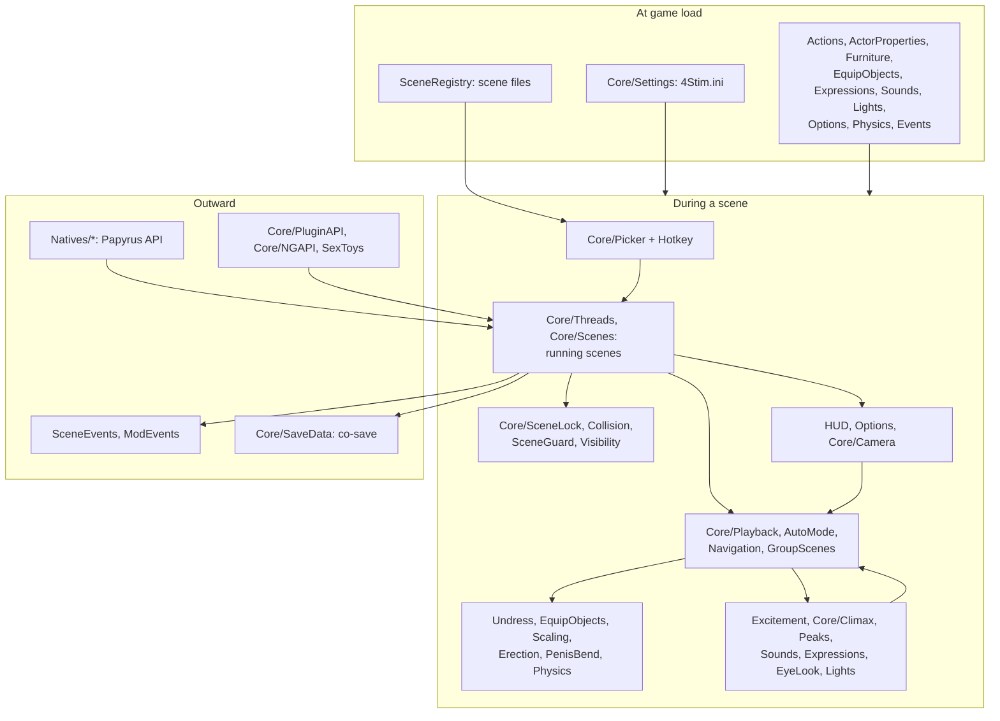

# Architecture

How 4Stim is put together and how a scene's data and events move through
it (roadmap 1.7). Where each piece of code lives is in
docs/SOURCE_LAYOUT.md; why it differs from OStim is in DECISIONS.md.

## The parts

| Part | Where | What it does |
|---|---|---|
| **Native plugin** `4Stim.dll` | `src/` (C++23, CommonLibF4, xmake) | Almost everything: reads the data files, picks and runs scenes, holds actors in place, plays animations, excitement, events, sounds, faces, undressing, scaling, physics swaps, the HUD's data, the co-save, and the Papyrus and C++ APIs. |
| **Papyrus scripts** | `Data/Scripts/Source/User/` | The steps only Papyrus can do (restraining, `TranslateTo`, `EquipItem`, faction ranks, LooksMenu and FSMP calls), the scene setup's order, MCM callbacks, and OStim's Papyrus API under 4Stim's names (`FourThread`, `FourActor`, `FourMetadata`...). |
| **HUD and picker** | `Interface-src/` (ActionScript 3) → `Data/Interface/*.swf` | Draws the picker and the in-scene HUD. Draws only: the plugin sends it what to show and gets back what was chosen (docs/HUD_API.md). |
| **Data files** | `Data/F4SE/Plugins/4Stim/` | Scenes, action types, actor properties, furniture types, equip objects, expressions, voice sets, lights, options, physics swaps, events: OStim's formats, read at startup or when the picker opens. |
| **Settings** | `Data/F4SE/Plugins/4Stim.ini`, `Data/MCM/Config/4Stim/` | One ini; the MCM page writes the same settings. |
| **`4Stim.esl`** | `Data/` | OStim's API factions, form lists and keywords (docs/API.md). |
| **Animation packs** | Their own plugins (Idle records) and scene files | What gets played (docs/SCENES.md). |

## Inside the plugin

- **`main.cpp`** registers with F4SE and answers its messages (game loaded,
  save loaded, new game): loads the settings and data, registers the natives,
  serialization and event sinks.
- **`Core/`** is the scene engine (docs/SOURCE_LAYOUT.md has a line per
  file). Shared state and declarations are in `Core/Core.h`.
- **The systems beside it** (`Actions`, `Excitement`, `Undress`,
  `Furniture`, `SceneRegistry`, `HUD`, `Physics`...) each own one subject
  and its data files, with their own headers.
- **`Scheduler`** runs every "a moment later" on one thread, then hands the
  work to the main thread.

## Threads

The game's objects (actors, 3D, inventory) are touched on the main thread:
F4SE's task queue (`F4SE::GetTaskInterface()->AddTask`). Papyrus calls run on
the VM's threads, the HUD's callbacks on the UI's, delays on the scheduler's;
each queues its game work as a task. What must happen in Papyrus (restraint,
translation, equipping) goes out as a Papyrus call (`CallActorMethod`,
`Dispatch`) and comes back later. Reads that are safe anywhere (settings,
scene data) are under locks.

## A scene, start to end

1. **Asking.** The hotkey (`Core/Hotkey`) opens the picker
   (`Core/Picker`): who (actors near, actor properties), where (furniture
   near, `Furniture`), then a scene that fits them (`SceneRegistry`, roles'
   requirements). Mods can start one instead: `FourThreadBuilder` /
   `FourThread` in Papyrus, the C++ APIs.
2. **Setting up** (`Core/Threads`, `Core/Scenes`, then
   `FourStimScene.psc` for the Papyrus steps). The order matters and is
   written in `FourStimScene.psc`: interaction blocked, weapons sheathed,
   actors moved and placed (collision between them off first), restrained,
   locked to their spot (`TranslateTo`), scaled (`Scaling`), undressed
   (`Undress`), the scene package on NPCs (`ScenePackage`), physics swapped
   (`Physics`), erections (`Erection`).
3. **Playing** (`Core/Playback`). Each role's Idle is played on the same
   frame; `AnimCues` times the animation's annotations; the HUD shows the
   scene. Every tick: excitement (`Excitement`), climax (`Core/Climax`),
   events and peaks (`Events`, `Peaks`), sounds, faces, eye directions,
   lights, equip objects as actions need them, the scene guard
   (`Core/SceneGuard`) putting back anyone pushed off their spot.
4. **Moving on.** The player's navigation and speed keys
   (`Core/Navigation`), auto mode (`Core/AutoMode`), sequences and
   transitions change the scene; the new scene's actions re-undress,
   re-scale and re-equip as needed.
5. **Ending** (climax with `SetEndOnOrgasm`, the HUD, a script, damage or an
   actor lost). Everything is undone in reverse: equip objects off,
   physics and erections back, redressing, scale back, unlocked, packages
   re-evaluated, NPCs back where they stood. Ending is safe to run more than
   once.

At each step `SceneEvents` and `ModEvents` tell registered scripts
(`FourStim_OnSceneStart`, scene change, speed, climax, end), and the C++ APIs
send the same to plugins.

## Saving and loading

`Core/SaveData` keeps, in the F4SE co-save: the running scenes, each
actor's chosen equip objects, voice sets per actor base and stimulation
overrides (OStim's Serialization). Saved scenes are released on load
(`bResumeScenes=0`, as OStim ends them) or, with 1, started again.
Alignments aren't in the save: they're in
`Documents\My Games\Fallout4\4Stim\alignment.json`, as OStim keeps its
`alignment.json` in its own Documents folder.

## Talking to the HUD

The plugin pushes the HUD's state (tabs, navigation, meters, options) into
the SWF and gets back choices through registered callbacks, all through
the API in docs/HUD_API.md. The SWF holds no scene logic, so it can be
restyled or replaced.
